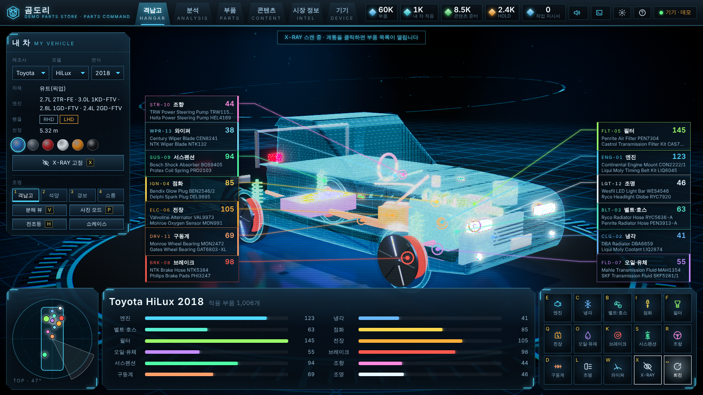
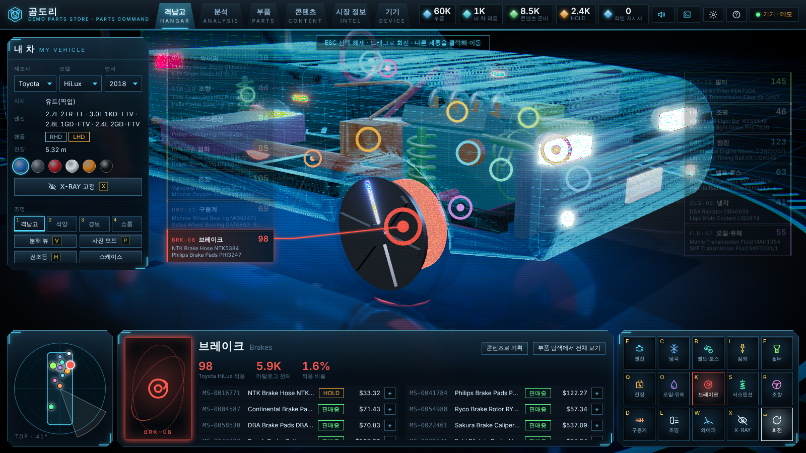
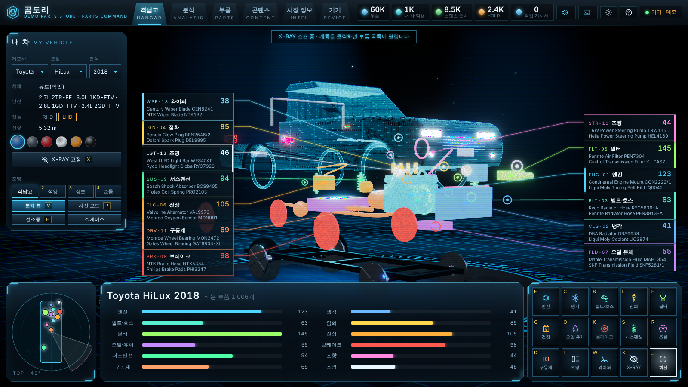
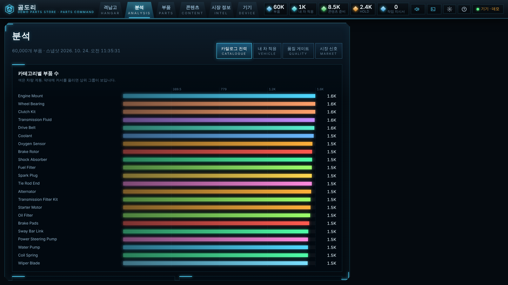
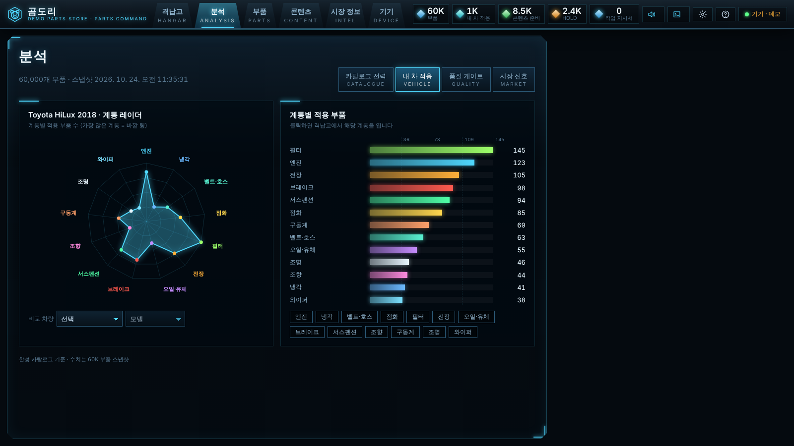
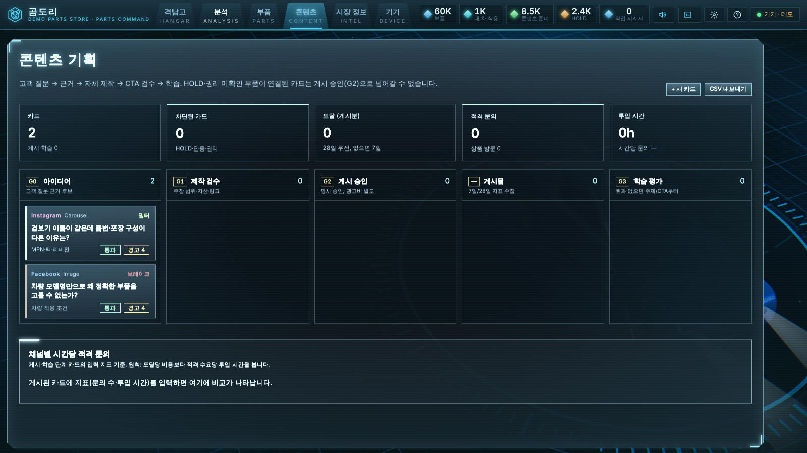
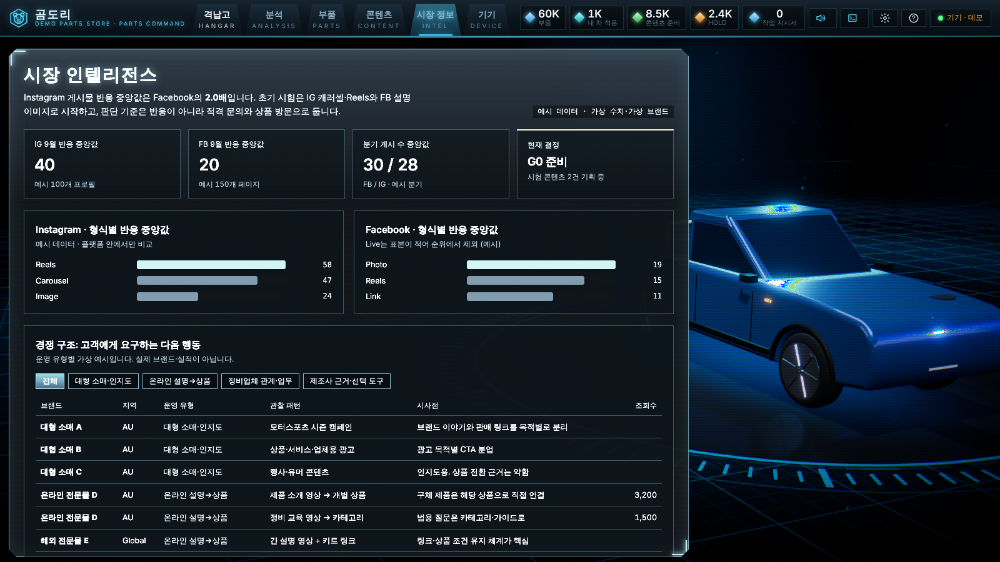
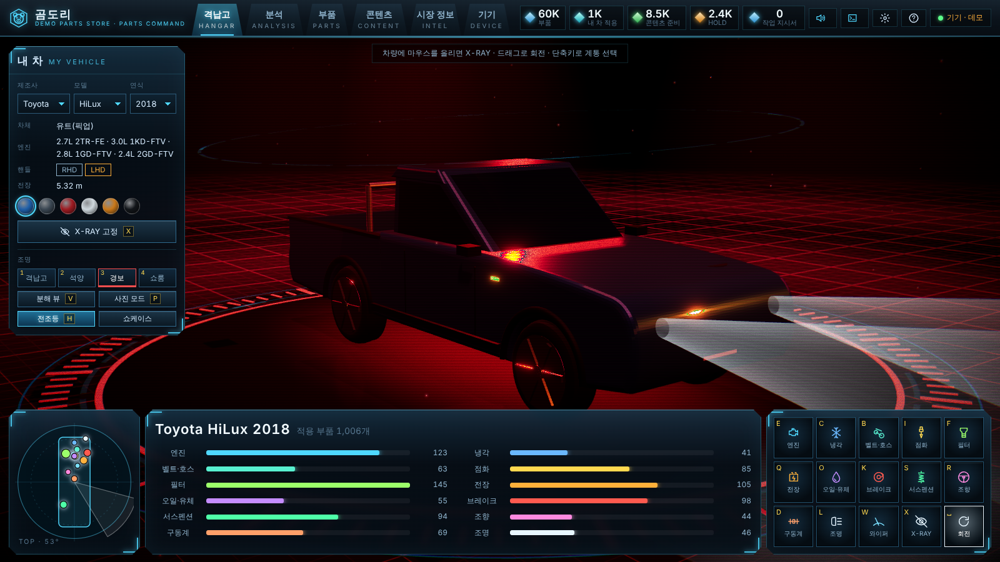
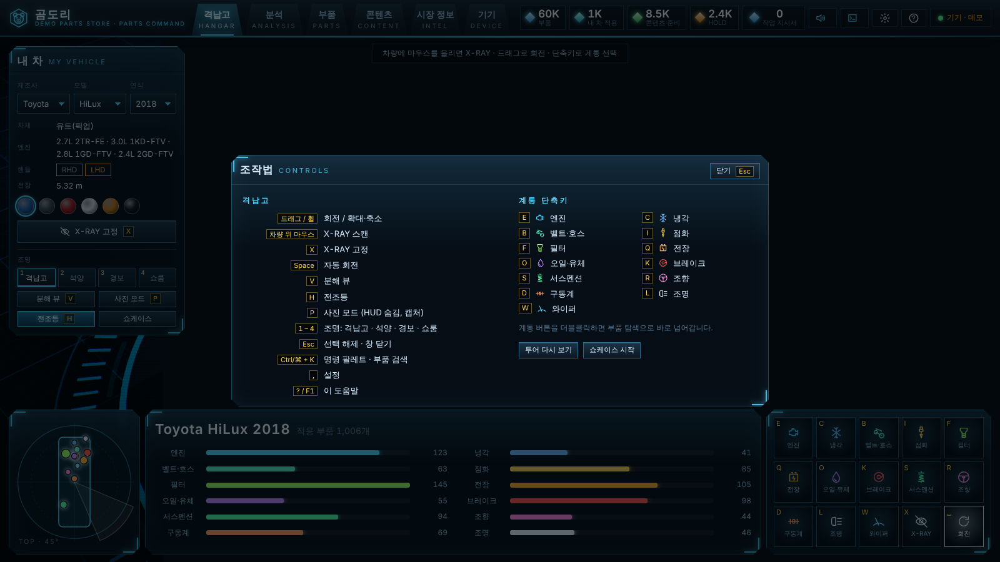

# 곰도리

호주 자동차 애프터마켓(부품 온라인 판매) 마케팅 담당자를 위한 3D 부품·마케팅 대시보드입니다.
**100만 개 이상 부품 데이터베이스**가 들어갈 수 있는 구조의 모노레포이고, GitHub Pages에서는 API 없이 브라우저 안에서 만든 데모 카탈로그로 동작합니다.

> 과제 제출용 공개 저장소입니다. 가게 이름(DEMO PARTS STORE), 부품 데이터, 시장 정보 탭의 수치·브랜드는 모두 **가상 예시**입니다.

설계와 확장 경로는 [docs/ARCHITECTURE.md](docs/ARCHITECTURE.md), 대시보드 요약은 [docs/DASHBOARD.md](docs/DASHBOARD.md), 재현용 프롬프트 기록은 [docs/PROMPTS.md](docs/PROMPTS.md)에 있습니다.

## 빠른 시작 (Windows / macOS / Linux 공통)

필요한 것: **Node.js 22.13 이상** (22 LTS 또는 24). 별도 패키지 매니저 없이 Node에 들어 있는 **npm**만 씁니다.

```bash
npm install
npm run dev               # 웹만 실행 → http://localhost:5173
```

API 서버 없이도 바로 동작합니다. 서버가 없으면 브라우저 안에서 합성 부품 60,000개짜리 데모 카탈로그를 만들어
(처음 한 번, 수십 초) 기기에 저장하고 그걸로 모든 화면이 돕니다. 상단 오른쪽에 `기기 · 데모`로 표시됩니다.
주소에 `?demo=200000`을 붙이면 데모 규모를 바꿀 수 있습니다(기기 탭 → 기기 데이터 지우기 후 새로고침).

100만 건 서버 모드로 돌리려면 터미널 두 개에서:

```bash
npm run seed              # 합성 부품 1,000,000개 → data/parts.db (수 분, 약 870MB)
npm run dev:api           # http://localhost:8787  (seed를 건너뛰면 처음 실행 때 50,000개로 자동 생성)
npm run dev:web           # http://localhost:5173  (/api, /sync는 8787로 프록시)
```

| 명령 | 하는 일 |
|---|---|
| `npm test` | 코어·동기화 테스트 (오프라인 수정 → 푸시 → 수렴, 커서 완전성 등) |
| `npm run typecheck` | 전 패키지 타입 검사 |
| `npm run bench` | 1M 카탈로그 쿼리 지연 측정 |
| `npm run build` | 웹 프로덕션 빌드 → `apps/web/dist` |

> Windows PowerShell에서 `pnpm`을 찾지 못한다는 오류가 났다면, 이제 pnpm은 필요 없습니다. `npm install` / `npm run dev`를 쓰세요.

## GitHub Pages 배포

`.github/workflows/pages.yml`이 `main`에 push할 때마다 테스트 → 빌드 → Pages 배포를 합니다.

1. 이 폴더를 새 **Public** 저장소로 push합니다(브랜치 `main`).
2. 저장소 **Settings → Pages → Build and deployment → Source**를 **GitHub Actions**로 바꿉니다.
3. **Actions** 탭에서 `Deploy to GitHub Pages`가 초록색이 되면 `https://<계정>.github.io/<저장소>/`에서 열립니다.

빌드할 때 저장소 이름으로 경로(`VITE_BASE=/<저장소>/`)를 맞추므로 저장소 이름은 무엇이든 됩니다.
서버가 없는 정적 배포라 아래 **데모 모드**로 동작합니다(첫 방문 때 부품 60,000개를 브라우저에서 생성, 수십 초).

Vercel에서도 루트의 `vercel.json` 그대로 배포됩니다(Framework Preset: Other, Node 22.x 이상).

## 화면 (3D 커맨드 콘솔)



전체 화면 WebGL 격납고 위에 RTS 커맨드 콘솔 형태의 HUD를 얹었습니다. 로그인은 없습니다.

| 탭 | 내용 |
|---|---|
| **격납고** | 내 차(제조사·모델·연식)가 받침대 위에서 회전. 마우스를 올리면 앞에서부터 X-RAY 스캔, 13개 계통이 긴 리더 라인으로 부품 목록 카드와 연결. 클릭하면 카메라가 날아가고 하단 정보 패널에 실제 적용 부품 목록 → 부품 상세 드로어 |
| **분석** | 통계를 그래프로: 카테고리/브랜드 막대, 내 차 계통 레이더(다른 차량과 겹쳐 비교 + 계통별 차이), Gate 0 게이지, 근거·권리·상태 도넛, 시장 형식별 컬럼 |
| **부품** | 100만 건 탐색기(검색·필터·가상 스크롤·커서, 결과 CSV 내보내기). 격납고에서 넘어오면 차량·계통 필터가 미리 채워짐. 상세 드로어에서 작업 지시서 추가·콘텐츠 기획 |
| **콘텐츠** | 콘텐츠 운영 칸반(아이디어 → G1 제작 검수 → G2 게시 승인 → 게시됨 → G3 학습 평가). HOLD·단종·권리 미확인 부품이나 체크리스트 미완료 카드는 G2로 못 넘어감. 7일/28일 지표, 채널별 시간당 적격 문의 차트, CSV |
| **시장 정보** | 운영 유형별 경쟁 패턴·채널 계획·게이트 (가상 예시 데이터) |
| **기기** | 범위 복제(OPFS), 오프라인 검색·수정, 동기화 |

**조작**: 드래그 = 회전 · 휠 = 줌 · 차량 위 마우스 = X-RAY · `E C B I F Q O K S R D L W` = 계통 선택 · `X` = X-RAY 고정 · `Space` = 자동 회전 · `Esc` = 선택 해제 · `V` = 분해 뷰 · `P` = 사진 모드(캡처 PNG) · `1–4` = 조명(격납고/석양/경보/쇼룸) · `H` = 전조등 · `Ctrl/⌘+K` = 명령 팔레트(이동·연출·부품 검색, 최근 부품) · `,` = 설정 · `?`/`F1` = 조작법

**연출**: 부팅 후 카메라 플라이인, X-RAY 스캔 시 홀로그램 스캔 시트, 계통 선택 시 바닥 충격파 + 데이터 기둥 + 카메라 펀치, 차량 주위 궤도 링. 30초 동안 입력이 없으면(또는 `쇼케이스` 버튼) 카메라가 돌며 조명·X-RAY를 순환하는 쇼케이스 모드.

**설정**: 렌더링 품질(자동 — 내장 그래픽이면 '보통': 해상도 배율·MSAA·그림자·반사 바닥을 낮춤, '낮음'은 반사 바닥 없음), 블룸·색수차·스캔라인·입자·카메라 흔들림 끄기, 동작 줄이기, 효과음 볼륨, 격납고 앰비언스, HUD 크기(90/100/110%). 첫 방문 시 5단계 투어(`?notour`로 생략).

**작업 지시서**: 헤더 오른쪽 버튼. 정보 패널·드로어·팔레트의 `+`로 부품을 담으면 내 차 적용 여부·HOLD·단종·재고를 경고하고 GST 10% 포함 합계, CSV/텍스트 복사. 지시서·콘텐츠 카드·사운드 설정은 이 브라우저에 저장됩니다.

**`?2d`**: URL에 붙이면 WebGL 없이 HUD만 띄웁니다(구형 GPU, 스크린샷, 접근성).

| | |
|---|---|
|  |  |
|  |  |
|  |  |
|  |  |

헤더 오른쪽 `자동/엣지/기기`: **자동**(복제된 범위는 기기에서, 나머지는 엣지), **엣지 API**, **이 기기만**.

## 데이터에 대해

`npm run seed`(와 브라우저 데모)가 만드는 부품은 **합성 데이터**입니다. 부품 브랜드 이름은 실제 판매 브랜드를 빌렸지만 품번·GTIN·가격·적용 차량은 모두 생성값이고,
시장 정보 탭의 경쟁사·수치는 가상 예시입니다. 실제 상품/제조사 데이터는 `packages/sql` 스키마로 적재하면 됩니다.

## 구조

```
packages/core   타입 · PartQuery 계약 · 포트 · HLC/ULID · 시장 정보 예시 데이터
packages/sql    SQLite 스키마 · 리포지토리 · 어댑터(node:sqlite / D1 / libSQL)
packages/sync   동기화 프로토콜 · 서버 스냅샷 · 기기 SyncClient
apps/api        Hono API (Node 엔트리, Cloudflare Workers 엔트리 템플릿)
apps/web        React HUD · three.js 격납고(src/three) · HUD/차트(src/hud) · sqlite-wasm/OPFS 워커
tools/seed      합성 카탈로그 생성기 · 벤치마크
```
